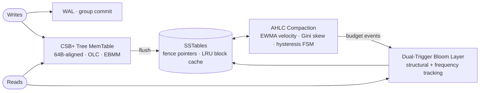

 

<a href="#flagship">Flagship</a> &nbsp;·&nbsp;
<a href="#featured">Featured</a> &nbsp;·&nbsp;
<a href="#forecasting-research">Forecasting</a> &nbsp;·&nbsp;
<a href="#applied-systems">Applied</a> &nbsp;·&nbsp;
<a href="#toolkit">Toolkit</a> &nbsp;·&nbsp;
<a href="#contact">Contact</a>

---

## Flagship

### [CASCADE](https://github.com/dEvAsTaTiNg0009/CASCADE)
**Cache-Sensitive Adaptive Storage Architecture for Dynamic and Efficient LSM-Tree Design**

   

A research-grade LSM key-value storage engine that co-designs three subsystems usually tuned in isolation: the memtable, the compaction policy, and the Bloom filter layer. Each one feeds signals to the next.

<table>
<tr>
<td align="center" width="25%"><h3>5.5M</h3>ops/s · read-only (YCSB-C)</td>
<td align="center" width="25%"><h3>3.05M</h3>ops/s · 50/50 read-update (YCSB-A)</td>
<td align="center" width="25%"><h3>≤ 0.4 µs</h3>P99 latency (YCSB A–D)</td>
<td align="center" width="25%"><h3>3.11× → 1.13×</h3>write amplification uniform → skewed load</td>
</tr>
</table>

<table>
<tr>
<td width="33%" valign="top">

**① Concurrent CSB⁺-Tree MemTable**

64-byte cache-line-aligned nodes, optimistic lock coupling, epoch-based memory reclamation.

</td>
<td width="33%" valign="top">

**② Adaptive Hybrid Lightweight Compaction**

Switches policy from live telemetry (EWMA write velocity, Gini access skew, level saturation), with a hysteresis FSM to prevent thrashing.

</td>
<td width="33%" valign="top">

**③ Dual-Trigger Blocked Bloom Layer**

Reallocates filter budget on compaction events, and also by access frequency through a sliding-window tracker.

</td>
</tr>
</table>

<b>Architecture</b> — how the subsystems connect

 

<b>YCSB A–F benchmark results</b>

 

| Workload | Mix | Throughput | WAF | Bloom FPR | P99 | P99.9 |
|---|---|---|---|---|---|---|
| A | 50% read / 50% update | **3,052K ops/s** | 1.13× | 0.016% | 0.4 µs | 1.6 µs |
| B | 95% read / 5% update | **4,651K ops/s** | 1.24× | 0.052% | 0.2 µs | 1.6 µs |
| C | 100% read | **5,528K ops/s** | 1.33× | 0.040% | 0.2 µs | 1.6 µs |
| D | 95% read / 5% insert | **4,328K ops/s** | 1.24× | 0.037% | 0.2 µs | 0.8 µs |
| E | 95% scan / 5% insert | **827K ops/s** | 1.09× | 0.000% | — | — |
| F | 50% read / 50% RMW | **2,282K ops/s** | 4.21× | 0.364% | 0.4 µs | 1.6 µs |

Measured with the in-repo YCSB harness (scrambled Zipfian generator). Full read/space amplification figures are in the repo.

<b>Adaptivity under workload skew</b> — Zipfian θ sweep on Workload A

 

| θ | Distribution | Throughput | Write amp | Policy switches |
|---|---|---|---|---|
| 0.00 | Uniform | 2,363.5K ops/s | 3.11× | 2 |
| 0.80 | Moderate skew | 2,572.7K ops/s | 2.09× | 1 |
| 0.90 | High skew | 3,023.1K ops/s | 1.13× | 1 |
| 0.99 | Extreme skew | **3,157.1K ops/s** | **1.13×** | 1 |

<b>Engineering</b> — correctness and tooling

 

- Write-ahead log with group-commit batching
- Lock-free HDR latency histograms and RUM-triad (read, update, memory) accounting
- AddressSanitizer, UBSan and ThreadSanitizer build targets
- Full test suite across every stage, plus an ablation runner

---

## Featured

### [Bitcoin Anomaly Detection](https://github.com/dEvAsTaTiNg0009/bitcoin-anomaly-detection)
<!-- TODO: update the link above after renaming the repo -->

  

Detecting anomalous behaviour in Bitcoin time-series data.
<!-- TODO: one line on the data source (market / on-chain), the method, and one headline result -->

<b>Approach and results</b>

 

<!-- TODO: fill in -->
| | |
|---|---|
| **Data** | — |
| **Method** | — |
| **Evaluation** | — |
| **Result** | — |

---

## Forecasting Research

Both projects share one principle: **no information from the future touches the model.** I prefer honest, calibrated probabilities over inflated accuracy.

<table>
<tr>
<td width="50%" valign="top">

### [Stochastic Cricket Prediction](https://github.com/dEvAsTaTiNg0009/Stochastic-Cricket-Prediction)

Strictly causal IPL match forecasting trained on 18 seasons of ball-by-ball data (2008–2025).

`638 blind walk-forward matches` `10/10 leakage red-team tests` `SHA-256 frozen 2026 holdout`

</td>
<td width="50%" valign="top">

### [Football Prediction](https://github.com/dEvAsTaTiNg0009/football-predictor)

Leakage-free match forecasting with strict temporal validation and calibrated outcome probabilities.

`Temporal validation` `Probabilistic outputs` `Calibration`

</td>
</tr>
</table>

<b>Cricket — methodology and evaluation</b>

 

**Pipeline:** frozen historical state → causal feature engine (7 interpretable feature families, 69 features) → regularized base models → chronological out-of-fold predictions → Elastic Net meta-learner → isotonic calibration.

**Ensemble after pruning:** Bayesian Bradley-Terry, MLP, Gradient Boosting and Logistic Regression were kept. XGBoost, LightGBM and ExtraTrees were pruned by the meta-learner as redundant.

| Evaluation (2016–2025, pre-XI mode) | Value |
|---|---|
| Blind held-out matches | 638 |
| Accuracy | 51.7% (ELO baseline 49.5%) |
| Log loss / Brier | 0.7245 / 0.2616 |

T20 outcomes are close to coin-flip before the toss. The project measures how much signal actually exists, without leakage inflating it.

---

## Applied Systems

### [Pravesh](https://github.com/dEvAsTaTiNg0009/Pravesh)
**Smart campus entry infrastructure** — a QR-based entry/exit platform running at campus scale: **2,500+ users** and **~500 verified entries per day**.

---

## Toolkit

   
  

<b>Full stack</b>

 

| | |
|---|---|
| **Languages** | C · C++ · Python · Java · Dart |
| **ML & Stats** | PyTorch · scikit-learn · XGBoost · LightGBM · pandas · NumPy |
| **Systems** | Linux · concurrency · sanitizers (ASan / TSan) · MySQL |
| **Application** | Node.js · React · Flutter · Firebase |
| **Vision** | OpenCV |
| **Workflow** | Git · Jupyter · Figma |

**Going deeper into:** `Probability` `Statistics` `Optimization` `Econometrics` `Time Series` `Statistical Learning` `Quantitative Finance`

---

## Contact

Open to conversations about storage systems, forecasting, and quantitative research.

Build. Test. Question. Repeat.

