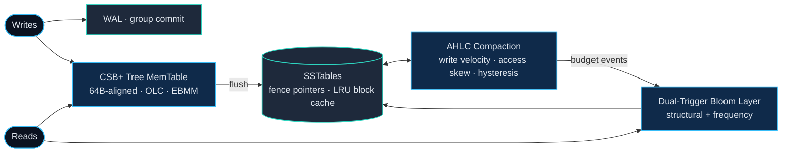

 

<a href="#cascade">CASCADE</a> &nbsp;·&nbsp;
<a href="#bitcoin-anomaly-detection">Bitcoin Anomaly Detection</a> &nbsp;·&nbsp;
<a href="#pravesh">Pravesh</a> &nbsp;·&nbsp;
<a href="#forecasting-research">Forecasting</a> &nbsp;·&nbsp;
<a href="#toolkit">Toolkit</a> &nbsp;·&nbsp;
<a href="#contact">Contact</a>

---

$\color{#38BDF8}{\textsf{01 / FLAGSHIP / STORAGE SYSTEMS}}$

## [CASCADE](https://github.com/dEvAsTaTiNg0009/CASCADE)

**Cache-Sensitive Adaptive Storage Architecture for Dynamic and Efficient LSM-Tree Design**

   

CASCADE is a key-value storage engine in modern C++17. Most LSM engines tune the memtable, the compaction policy and the Bloom filters as separate problems. In CASCADE they share live workload signals and adapt together. The result is millions of operations per second, sub-microsecond tail latency, and write amplification that *drops* as the workload gets more skewed.

<table>
<tr>
<td align="center" width="25%">

$\color{#38BDF8}{\Large\textbf{5.5M}}$

ops/s · read-only YCSB-C

</td>
<td align="center" width="25%">

$\color{#38BDF8}{\Large\textbf{3.05M}}$

ops/s · 50/50 read-update YCSB-A

</td>
<td align="center" width="25%">

$\color{#38BDF8}{\Large\mathbf{\leq 0.4\,\mu s}}$

P99 latency YCSB A–D

</td>
<td align="center" width="25%">

$\color{#38BDF8}{\Large\mathbf{3.11\times \rightarrow 1.13\times}}$

write amplification uniform → skewed load

</td>
</tr>
</table>

<table>
<tr>
<td width="33%" valign="top">

$\color{#38BDF8}{\textsf{① MEMTABLE}}$

**Concurrent CSB⁺-Tree**

Nodes aligned to 64-byte cache lines, optimistic lock coupling for concurrent writers, and epoch-based memory reclamation.

</td>
<td width="33%" valign="top">

$\color{#38BDF8}{\textsf{② COMPACTION}}$

**Adaptive Hybrid (AHLC)**

Picks the compaction policy at runtime from write velocity, access skew and level saturation. A hysteresis state machine keeps it from thrashing between policies.

</td>
<td width="33%" valign="top">

$\color{#38BDF8}{\textsf{③ FILTERS}}$

**Dual-Trigger Blocked Bloom**

Moves filter memory where it pays off. It reacts both to compaction events and to observed access frequency.

</td>
</tr>
</table>

<b>Architecture</b> — how the three subsystems talk to each other

 

<b>YCSB A–F benchmark results</b>

 

| Workload | Mix | Throughput | WAF | Bloom FPR | P99 | P99.9 |
|---|---|---|---|---|---|---|
| A | 50% read / 50% update | **3,052K ops/s** | 1.13× | 0.016% | 0.4 µs | 1.6 µs |
| B | 95% read / 5% update | **4,651K ops/s** | 1.24× | 0.052% | 0.2 µs | 1.6 µs |
| C | 100% read | **5,528K ops/s** | 1.33× | 0.040% | 0.2 µs | 1.6 µs |
| D | 95% read / 5% insert | **4,328K ops/s** | 1.24× | 0.037% | 0.2 µs | 0.8 µs |
| E | 95% scan / 5% insert | **827K ops/s** | 1.09× | 0.000% | — | — |
| F | 50% read / 50% RMW | **2,282K ops/s** | 4.21× | 0.364% | 0.4 µs | 1.6 µs |

Measured with the in-repo YCSB harness using a scrambled Zipfian generator. Read and space amplification figures are in the repo.

<b>Adaptivity under skew</b> — Zipfian θ sweep on Workload A

 

As access patterns concentrate, AHLC shifts policy and write amplification falls by almost two-thirds.

| θ | Distribution | Throughput | Write amp | Policy switches |
|---|---|---|---|---|
| 0.00 | Uniform | 2,363.5K ops/s | 3.11× | 2 |
| 0.80 | Moderate skew | 2,572.7K ops/s | 2.09× | 1 |
| 0.90 | High skew | 3,023.1K ops/s | 1.13× | 1 |
| 0.99 | Extreme skew | **3,157.1K ops/s** | **1.13×** | 1 |

<b>Engineering</b> — durability, measurement and correctness

 

- **Durability:** write-ahead log with group-commit batching
- **Measurement:** lock-free HDR latency histograms and full read/write/space amplification accounting
- **Correctness:** AddressSanitizer, UBSan and ThreadSanitizer build targets, plus a test suite covering every stage
- **Analysis:** a built-in ablation runner to isolate each subsystem's contribution

---

$\color{#818CF8}{\textsf{02 / FEATURED / MACHINE LEARNING}}$

## [Bitcoin Anomaly Detection](https://github.com/dEvAsTaTiNg0009/bitcoin-anomaly-detection)
<!-- TODO: update the link above after renaming the repo -->

  

Finds the moments when Bitcoin stops behaving like itself. The system flags statistically unusual activity in Bitcoin time-series data and separates real anomalies from ordinary volatility.
<!-- TODO: one line naming the data source (market / on-chain), the method, and one headline result -->

<b>Approach and results</b>

 

<!-- TODO: fill in -->
| | |
|---|---|
| **Data** | — |
| **Method** | — |
| **Evaluation** | — |
| **Result** | — |

---

$\color{#2DD4BF}{\textsf{03 / IN PRODUCTION / DEPLOYED PRODUCT}}$

## [Pravesh](https://github.com/dEvAsTaTiNg0009/Pravesh)

**Smart campus access, live and in daily use**

  

Pravesh is a shipped product, not a prototype. It runs campus entry and exit through QR-based identity verification: every person is verified at the gate, and every movement is logged with a timestamp. It serves a user base of more than 2,500 people and handles real traffic every day.

<table>
<tr>
<td align="center" width="33%">

$\color{#2DD4BF}{\Large\textbf{2,500+}}$

users on the platform

</td>
<td align="center" width="33%">

$\color{#2DD4BF}{\Large\mathbf{\sim 500}}$

verified entries every day

</td>
<td align="center" width="33%">

$\color{#2DD4BF}{\Large\textbf{Live}}$

deployed and running on campus

</td>
</tr>
</table>

<b>What it does</b>

 

- **Verify:** QR-based identity check at every entry and exit point
- **Record:** a time-stamped, auditable log of campus movement
- **Scale:** built for the daily load of a full campus population, not a demo

---

$\color{#818CF8}{\textsf{04 / RESEARCH / PROBABILISTIC FORECASTING}}$

## Forecasting Research

Both projects follow one rule: **a prediction may only use information that existed before the event.** Many sports models report inflated accuracy because the future leaks into training. These models are built to measure the signal that actually exists.

<table>
<tr>
<td width="50%" valign="top">

### [Stochastic Cricket Prediction](https://github.com/dEvAsTaTiNg0009/Stochastic-Cricket-Prediction)

A strictly causal IPL forecasting framework trained on 18 seasons of ball-by-ball data. It is audited by automated tests that actively try to leak future information into the model.

</td>
<td width="50%" valign="top">

### [Football Prediction](https://github.com/dEvAsTaTiNg0009/football-predictor)

Applies the same discipline to football: strictly time-ordered validation, no lookahead, and calibrated match-outcome probabilities instead of bare picks.

</td>
</tr>
</table>

<b>Cricket — methodology and evaluation</b>

 

**Pipeline:** frozen historical state → causal feature engine (7 interpretable feature families, 69 features) → regularized base models → chronological out-of-fold predictions → Elastic Net meta-learner → isotonic calibration.

**Ensemble:** Bayesian Bradley-Terry, MLP, Gradient Boosting and Logistic Regression were kept. XGBoost, LightGBM and ExtraTrees were pruned by the meta-learner as redundant.

| Evaluation (2016–2025, pre-XI mode) | Value |
|---|---|
| Blind held-out matches | 638 |
| Accuracy | 51.7% (ELO baseline 49.5%) |
| Log loss / Brier | 0.7245 / 0.2616 |

Before the toss, T20 outcomes sit close to a coin flip. The project quantifies how much real signal exists, with no leakage inflating the answer.

---

## Toolkit

   
  

<b>Full stack</b>

 

| | |
|---|---|
| **Languages** | C · C++ · Python · Java · Dart |
| **ML & Stats** | PyTorch · scikit-learn · XGBoost · LightGBM · pandas · NumPy |
| **Systems** | Linux · concurrency · sanitizers (ASan / TSan) · MySQL |
| **Application** | Node.js · React · Flutter · Firebase |
| **Vision** | OpenCV |
| **Workflow** | Git · Jupyter · Figma |

  
  
  
  
  
  
  

---

## Contact

Always up for a conversation about storage systems, forecasting, or quantitative research.

